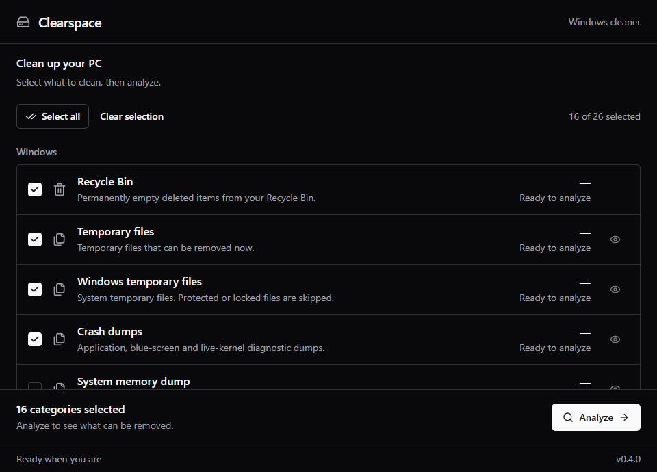

# Clearspace

A small Windows cleaner built with Python and a dark React interface using Radix/shadcn components. Select categories, analyze their size, and confirm cleanup.



## Version 0.5.0

- Opens without a Windows permission prompt. When selected system cleanup needs it, **Restart as administrator** asks Windows once; cancelling keeps the app open.
- Portuguese (Brazil) and English interface; the **PT/EN** button switches language, which starts matching Windows.
- Shows the system drive's free space. After an analysis, categories with nothing to clean collapse into one list.
- Taskbar progress while analyzing or cleaning, and a Windows notification when it finishes in the background.
- App icon.

## Version 0.4.1

- No minimum file age: recent temporary files and caches are eligible too.
- 34 categories covering the Recycle Bin, temporary files, diagnostics, caches, recent histories, and native Windows maintenance.
- Windows update/component cleanup through DISM, plus Delivery Optimization cache cleanup through its Windows module.
- Slow Windows analyses have their own wait budget. Native operations queue without overlap; unfinished work is marked pending instead of a cleanup failure.
- One launcher: `start.cmd`.
- Recent-file shortcuts, recent-document records, Run dialog commands, and File Explorer search history.
- Expanded crash dumps and Windows setup/update logs, plus Steam and Slack rendering caches.
- A direct category list with **Select all** and **Clear selection**. Unavailable categories stay collapsed.
- File previews, category totals, cancellation, and a result summary.
- Active applications, locked files, changed files, links, and unsupported locations are skipped.
- Selected categories are remembered locally. Cleanup never starts automatically.

Clearspace removes selected data permanently after the review confirmation. Recycle Bin cleanup is optional and starts unchecked. It uses Windows to empty the current user's bins across drives; recycled folders are included. The confirmation explains that newly recycled items may also be included. This native operation cannot be interrupted after it starts. A change in count or size since analysis skips the bin and asks for another analysis; matching totals do not prove individual item identities.

Original documents, installed applications, browser cookies/passwords, and pinned Jump List items are kept. Clearspace clears only specific selected history values in the registry; it does not repair or broadly prune the registry. Local Windows 10/11 x64 installations are supported.

Open **`start.cmd`** or the portable executable. The app opens with standard permission; protected system files are skipped. **Restart as administrator** reopens it elevated when selected system cleanup needs it; cancelling the Windows prompt keeps the current window. An already elevated app shows no prompt. Windows update/component and Delivery Optimization cleanup use Windows tools, preserve pinned downloads, never use DISM `/ResetBase`, and do not restart the computer. A pending Windows update/restart can prevent component cleanup. Once native maintenance starts, Stop prevents subsequent actions; the running Windows operation must finish.

Component-store analysis can take several minutes. Its native wait does not consume the filesystem analysis budget. Progress distinguishes analysis, cleanup and waiting for a previous command. Stop can end the app's wait without terminating Windows servicing; any Windows process still running is shown separately. If the wait limit is reached, the result says **Pending**, and a new analysis is required before unfinished cleanup can run.

The **Recent apps in Windows Search** list is separate from the `Recent` shortcuts folder and RecentDocs records. The app's **Open search history settings** button opens the supported Windows page; choose **Clear device search history** there. Clearspace does not claim that clearing Run/Explorer histories clears that modern app list, and does not reset CloudStore, UserAssist, pinned lists, or tracking preferences.

The catalog covers Chrome, Edge, Brave, Firefox, Opera/GX, Discord rendering caches, VS Code, Cursor, Epic Games Launcher, pip, npm and NuGet. Browser/app rules keep sign-ins, account data, projects and installed packages. Shader caches may be regenerated by games or graphics applications. See [cleaning rules and references](docs/cleaning-rules.md) for the exact locations and exclusions.

Sizes represent file data, not a guarantee of physically reclaimed disk space. Filesystem allocation, compression, open handles, and other running programs can affect free space.
Native maintenance may report no exact removed size. The result lists completed/failed actions separately from measured file bytes; a history cleanup remains available even when its size is zero.

## Run

Open `start.cmd` for the desktop app. The included portable Windows folder can run without installing Python or Node.js; Microsoft Edge WebView2 Runtime is required and normally comes with Windows 11.

For a source checkout, install Python 3.12 or newer, run `scripts\install.cmd`, then open `start.cmd`. Generated frontend assets are included, so Node.js is needed only when changing the interface. Build and setup helpers live in `scripts/`; the root contains only one application launcher.

```powershell
.\.venv\Scripts\python.exe -B -m clearspace scan
.\.venv\Scripts\python.exe -B -m clearspace scan --categories user_temp crash_dumps directx_cache
.\.venv\Scripts\python.exe -B -m clearspace clean --categories recycle_bin
.\.venv\Scripts\python.exe -B -m clearspace clean --categories recent_files run_history explorer_search_history recent_document_history
.\.venv\Scripts\python.exe -B -m clearspace scan --categories windows_components delivery_optimization
.\.venv\Scripts\python.exe -B -m clearspace clean
```

The terminal cleaner analyzes first and requires typing `clean` after showing its results. Running `scan` never deletes files. Without explicit category IDs, both interfaces start with recommended available categories.

## Development

```powershell
py -3.12 -m venv .venv
.\.venv\Scripts\python.exe -B -m pip install -c constraints.txt -e ".[build]"
.\.venv\Scripts\python.exe -B -m unittest discover -s tests -v
cd desktop-ui
pnpm install --frozen-lockfile
pnpm test
pnpm build
```

The Python service exposes a narrow in-process bridge to a local renderer. Browser content cannot submit deletion paths: cleanup accepts an existing scan ID and supported category IDs. Scan, filesystem validation, and deletion live in the Python engine, independently of the interface. Cache analysis probes deletion access without removing files; existing locks and changed file identities are checked again at cleanup. Recycle Bin analysis uses `SHQueryRecycleBinW`; confirmed cleanup uses `SHEmptyRecycleBinW`, without traversing `$Recycle.Bin`. Its summary reports bounded changes in item count and size, which concurrent activity can affect.

Native maintenance accepts only fixed provider IDs and fixed commands from the Windows system directory. History cleanup validates the exact scanned metadata and retains unknown values, settings, keys and changed data. Windows registry APIs have no conditional delete/writer lock: a concurrent change can still race an individual comparison, but the scope remains restricted to allowlisted history metadata. Tests delete only owned files and private test registry keys; native system cleanup is mocked.

Build the portable application with `python -B scripts/build_windows.py`. Build outputs are ignored by Git. Settings and summary reports are saved under the current user's local application data in `Clearspace`.

## References

The workflow draws inspiration from [BleachBit](https://www.bleachbit.org/features), [Microsoft PC Manager](https://pcmanager.microsoft.com/en-us), and [Windows Storage Sense](https://support.microsoft.com/en-us/windows/experience/storage-filemanagement/manage-drive-space-with-storage-sense). Clearspace is an independent implementation.

MIT licensed. Third-party component notices accompany the frontend and portable package.
